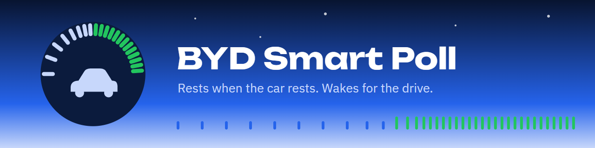

# BYD Smart Poll



Home Assistant integration that polls a BYD car only when it is worth it: slowly while
parked, every minute while driving, and timed to each percent while charging. It works
alongside the [BYD Vehicle](https://github.com/jkaberg/hass-byd-vehicle) integration and does
not talk to the BYD cloud itself.

This is a beta. Setup details, charger recipes and troubleshooting are in
[docs/setup.md](docs/setup.md).

## Why

Every BYD Vehicle poll is a live request to the car, which wakes its T-Box. While parked and
not charging, that comes out of the traction battery. With the default 300 s telemetry and
GPS polling, a Sealion 7 parked for a day showed about 0.14 %/h (roughly 115 W on average),
and polls that caught it awake showed it drawing 170 to 290 W. On the same car: 270 polls a
day, 44 % awake and 2.1 %/day lost at 300 s polling; 22 polls and 6 % awake at hourly.

While charging, a poll costs almost nothing (the charger supplies the power), so polls can be
timed to when the reading actually changes.

BYD never sends car data on its own. A drive or a charge is only seen when something polls
the car, or when another signal (your phone, your charger) says so. Smart Poll uses those
signals to decide when a poll is worth it.

## How it works

It sets BYD Vehicle's two poll interval numbers (telemetry and GPS) for each mode, and asks
for a single poll at the right moments (a normal BYD refresh).

| Mode | When | Telemetry | GPS |
|---|---|---|---|
| Driving | the car's "Vehicle on" sensor is on | 60 s | 120 s |
| Charging | charger power at or above the charging threshold (300 W), or the car says charging | timed per percent, 30 min backstop | 8 h |
| Expecting a drive | the wake window (10 min) after a phone connects to the car or a wake hint | 60 s | 8 h |
| Parked at home | cable connected, or last GPS fix at home with no drive since | 1 h | 8 h |
| Parked away | everything else, including when where the car is cannot be told | 1 h | 8 h |

All of these can be changed under Configure.

- **Starting a drive.** Your phone connecting to the car's Bluetooth (or a wake hint such as
  Android Auto or an iPhone Shortcut) starts the wake window: polls every minute, so the
  drive is seen soon after the car reports itself on. The window ends sooner if polls keep
  finding the car off once the phone has gone, so a phone reconnecting to a parked car costs
  a few polls, not ten.
- **After a drive.** One more GPS fix while the car is still awake, so it shows where it was
  parked, plus two readings about 3 and 8 minutes after parking, so a charge started right
  after a drive is seen within minutes.
- **Charging.** Energy is added up from the charger's power (or the car's own). The next poll
  is due when about one percent's worth has gone in. Energy per 1% is learned while charging,
  separately below and above 80 %. In simulation this gives 1 to 2 polls per percent, with the
  reading on average 0.5 to 2 minutes behind the car (fixed 300 s polling: 0.8 to 5 polls per
  percent, 2.3 to 2.8 minutes behind).
- **Missed drives.** At every parked poll the odometer is compared with the last one. If it
  moved, a drive was missed: GPS is fetched at once and the old fix is not trusted for "at
  home".
- **The car not answering.** BYD Vehicle hands back the last reading when the car cannot be
  reached. After two of Smart Poll's own polls in a row bring back the same reading while
  driving or charging, **Car data stale** turns on. Charge polls that bring nothing new back off (2 min, doubling up to 30 min).

Telemetry polls from here are never closer than 60 s apart. The BYD Vehicle "Disable polling" switch is
respected. The **Smart polling** switch turns this off and puts back the intervals you had
before. Removing or disabling the integration does the same.

## Signals

Every signal is optional and falls back to the car's own data.

| Signal | Used for | Without it |
|---|---|---|
| Charger power (W or kW) | charging seen at once, energy per percent | the car's charging state at polls, plus the two polls after a drive |
| Charger cable connected | "at home", one reading when unplugged | the car's last GPS fix in your home zone |
| Phone Bluetooth (Android) | a drive seen as it starts, for this car only | odometer check at parked polls |
| Wake hints (Android Auto, an iPhone Shortcut, others) | a drive seen as it starts | odometer check at parked polls |

A charger power sensor is strongly recommended if you charge at home. It must show only this
car charging: a shared charger, a plug with other things on it or a whole-house meter is
noticed and flagged in Repairs. See [Chargers](docs/setup.md#chargers) for common chargers.

iPhone: the iOS companion app has no Bluetooth sensor, so use a Shortcuts automation as a
wake hint. See [iPhone driver](docs/setup.md#iphone-driver).

## Entities

On a device of their own, named after the car ("<car> Smart Poll"):

- **Polling mode**: parked, charging, driving, expecting a drive, off. Attributes show the
  reason, at home, the signals in use, the last missed drive and, while charging, the energy
  added and when the next poll is due.
- **Estimated battery level**: the car's SoC, filled in between readings while charging.
- **Smart polling** switch.
- Diagnostic: **Energy per 1%**, **Car polls (24 h)**, **Parked awake share**, **Parked
  drain**, **Car data stale**. See [Diagnostics](docs/setup.md#diagnostics).

## Requirements

- Home Assistant 2025.2 or newer.
- [BYD Vehicle](https://github.com/jkaberg/hass-byd-vehicle) 0.0.88 or newer, set up for your
  car. 0.0.93 or newer applies interval changes immediately. With anything older, setup
  stops with a message saying which version is installed, and nothing is changed.

## Install

BYD Smart Poll is not in the Marketplace catalog yet, so you add it from its link.

**Home Assistant 2026.11 or newer (Marketplace).**

[](https://my.home-assistant.io/redirect/marketplace_repository/?owner=botts7&repository=byd-smart-poll&category=integration)

Or by hand: Settings, Marketplace, **Add from link**, enter `botts7/byd-smart-poll` (the
Marketplace asks you to connect GitHub the first time), then open BYD Smart Poll and select
**Install**. While only a beta exists, turn on its pre-releases first: Settings, Devices and
services, Marketplace, the BYD Smart Poll device, enable the **Pre-release** entity and turn
it on.

**Home Assistant 2025.2 to 2026.10 (HACS).** HACS, the three dots menu, Custom repositories.
Add `https://github.com/botts7/byd-smart-poll` with type Integration. Find BYD Smart Poll, download it (pick the beta under
Need a different version? while only a beta exists) and restart Home Assistant.

**Manual.** Copy `custom_components/byd_smart_poll` from this repository into the
`custom_components` folder of your Home Assistant config, then restart Home Assistant.

**Remove.** Settings, Devices and services, BYD Smart Poll, Delete. The BYD poll intervals go
back to what they were before Smart Poll (BYD's default 300 s if that is not known).

## Setup

1. Install as above. The Marketplace loads it straight away; after HACS or a manual copy,
   restart Home Assistant first.
2. [](https://my.home-assistant.io/redirect/config_flow_start/?domain=byd_smart_poll)

   Or Settings, Devices and services, Add integration, BYD Smart Poll. Setup asks one thing at a
   time: the car (and optionally its battery size), how you charge at home, who drives it,
   and (for Android phones) which paired Bluetooth device is the car. Everything after the
   car is optional.
3. The BYD "Vehicle on" sensor is disabled by default. Setup enables it; BYD Vehicle then
   reloads, and this integration starts about 30 s later.

Everything can be changed later under Configure. See [Options](docs/setup.md#options) for
each field, its default and when to change it.

Problems show up in Settings, Repairs: a signal that is missing, disabled or unavailable for
6 hours, a charger that is not charging this car, a cable sensor that does not match the
car, no charger sensor, or the car not found in BYD Vehicle. See
[Repairs](docs/setup.md#repairs).

## Development

```
PYTEST_DISABLE_PLUGIN_AUTOLOAD=1 python -m pytest
python tests/diag_sim.py      # simulated charges vs fixed 300 s polling
ruff check custom_components tests && ruff format --check custom_components tests && mypy custom_components/byd_smart_poll --ignore-missing-imports
```

The pure logic (`modes.py`, `charge_tracker.py`, `signals.py`, `signal_health.py`) has no
Home Assistant imports and is unit tested. The controller and removal tests drive the Home
Assistant glue with a small fake of its states and services, and need `homeassistant`
installed (CI pins the version); without it they are skipped. `PYTEST_DISABLE_PLUGIN_AUTOLOAD`
is needed on Windows, where the Home Assistant pytest plugin fails to load.
